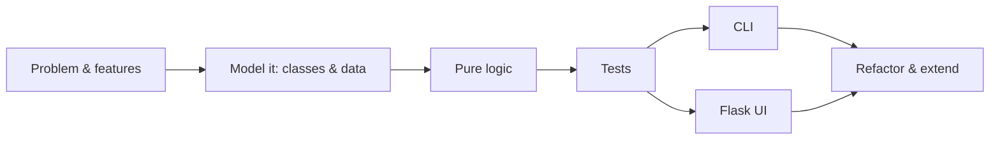

# 🐍 Python Projects: learn clean, object-oriented Python by building 20 apps

**20 end-to-end projects (10 beginner · 5 intermediate · 5 advanced) and 12 guides, served as a local learning website
with one command.** Every project has a step-by-step build guide, class and flow diagrams, the full source code, a test
suite you can run from the browser, and a small Flask UI you can use right on the page.

```bash
git clone https://github.com/KushalranaAI/Python-Projects.git
cd Python-Projects
python -m venv .venv && source .venv/bin/activate      # Windows: .venv\Scripts\activate
python start.py                                         # installs Flask etc. if needed, opens http://127.0.0.1:5050
```

Requires Python 3.10+. Nothing else: no Node, no database server.

---

## What you'll learn

- **Clean Python**: naming, small functions, guard clauses, type hints, dataclasses, enums, errors and validation
- **Object-oriented design**: classes, properties, encapsulation, inheritance, abstract classes, polymorphism, composition
- **Design patterns**: Repository, Strategy, Template method, Factory, State machine, Observer, Command, Facade
- **Project skills**: package layout, CLI tools, Flask web UIs, JSON/CSV/SQLite storage, pytest

Every project follows the same professional workflow:



## The projects

| # | Project | You'll practise |
|---|---|---|
| | **🌱 Beginner** | |
| 1 | 🎯 [Number Guessing Game](projects/beginner/number_guessing) | dataclass state, properties, injectable randomness, enums |
| 2 | 📏 [Unit Converter](projects/beginner/unit_converter) | data-driven design instead of if/elif, frozen dataclasses, regex |
| 3 | ✅ [To-Do List](projects/beginner/todo_list) | JSON storage layer, argparse sub-commands, sorting keys |
| 4 | 🔐 [Password Toolkit](projects/beginner/password_toolkit) | `secrets` vs `random`, entropy, policy objects |
| 5 | 🧠 [Quiz App](projects/beginner/quiz_app) | content as data, session objects, `__len__` |
| 6 | 🧾 [Bill Splitter](projects/beginner/bill_splitter) | Decimal and integer cents, the largest-remainder method |
| 7 | ✌️ [Rock Paper Scissors](projects/beginner/rock_paper_scissors) | abstract classes, polymorphism, opponents that learn |
| 8 | 📇 [Contact Book](projects/beginner/contact_book) | validation with per-field errors, CSV import/export |
| 9 | 📊 [Text Analyzer](projects/beginner/text_analyzer) | regex, Counter, readability formulas |
| 10 | 🪢 [Hangman](projects/beginner/hangman) | sets, minimal state with derived properties |
| | **🌿 Intermediate** | |
| 11 | 💸 [Expense Tracker](projects/intermediate/expense_tracker) | SQLite, repository + Protocol, pure reports, budgets |
| 12 | 📚 [Library Management System](projects/intermediate/library_system) | inheritance, ABCs, polymorphic rules and serialisation |
| 13 | 🔗 [URL Shortener](projects/intermediate/url_shortener) | base 62, URL validation, redirects, joins, fake clocks |
| 14 | 🏦 [Bank Account System](projects/intermediate/bank_system) | encapsulation, template method, atomic transfers, event sourcing |
| 15 | 🔥 [Habit Tracker](projects/intermediate/habit_tracker) | date logic, streak algorithms, testable time |
| | **🌳 Advanced** | |
| 16 | 🧮 [Mini Interpreter](projects/advanced/mini_interpreter) | lexer, recursive-descent parser, AST, `match`/`case` evaluator |
| 17 | 🔎 [Search Engine](projects/advanced/search_engine) | inverted index, stemming, phrase queries, BM25 and TF-IDF |
| 18 | 📋 [Kanban Board](projects/advanced/kanban_board) | layered architecture, REST API, drag and drop, WIP limits |
| 19 | 🛍️ [Online Shop](projects/advanced/online_shop) | Strategy, State machine and Observer working together |
| 20 | 🗝️ [Text Adventure Engine](projects/advanced/text_adventure) | Command pattern, data-driven worlds, save/load |

Each project folder looks the same:

```
projects/<level>/<name>/
├── README.md          the build guide (also rendered on the website)
├── <domain>.py        pure logic: classes and functions, no input()/print()
├── storage.py         (when needed) JSON / SQLite behind a small class
├── cli.py             terminal interface      →  python -m projects.<level>.<name>
├── web.py             Flask blueprint         →  python -m projects.<level>.<name>.web
├── templates/<name>/  HTML for the web UI
└── tests/             pytest
```

## Guides

1. From idea to project · 2. Project structure and running code · 3. Naming and functions ·
4. Type hints, dataclasses and enums · 5. Errors and validation · 6. Classes and objects ·
7. Inheritance, composition and polymorphism · 8. SOLID principles and design patterns ·
9. Testing with pytest · 10. Flask essentials · 11. Files, JSON, CSV and SQLite · 12. Clean code checklist

They live in [`guides/`](guides) and on the website.

## Running things without the website

```bash
python -m projects.beginner.todo_list add "Write tests" -p high     # any project's CLI
python -m projects.advanced.kanban_board.web                         # any project's own web app (port 5001)
python -m pytest                                                     # all 340 tests
python -m pytest projects/intermediate/bank_system -v                # one project's tests
```

Project data (to-do lists, databases…) is stored in `instance/`. It's git-ignored, so delete it to start fresh.

## Repository layout

```
start.py        one-command launcher for the learning website
hub/            the Flask website: catalog, project pages, code viewer, test runner, guides
projects/       the 20 projects (+ ui_kit, shared templates and data-path helpers)
guides/         12 Markdown guides
tests/          site-wide checks (every page renders, every project's metadata is complete)
```

The website only listens on `127.0.0.1`, because its "Run the tests" button executes code on your machine.

## License
MIT
