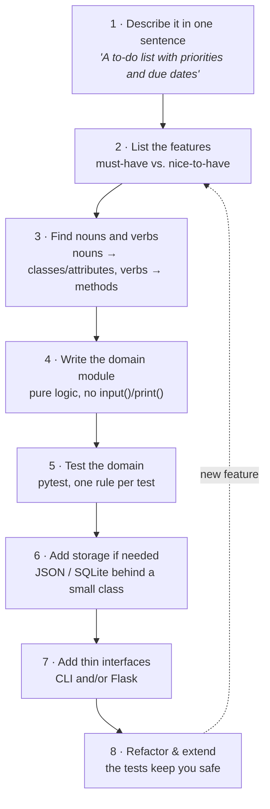

Most beginners start a project by opening an editor and typing `input(`. Professionals start somewhere else.
Here is the workflow all 20 projects follow. Use it for your own ideas too.



## 1. One sentence
If you can't describe the project in one sentence, it's two projects. *"A bill splitter that handles shared items,
tax and tip, exact to the cent"* is a good sentence: it already names the hard parts.

## 2. Features, then cut them
Write every feature you can imagine, then mark the **minimum** that makes the project useful. Build that first.
Everything else becomes an exercise for later. (Every project in this course ends with exactly such a list.)

## 3. Nouns and verbs
Read your feature list and underline the nouns and verbs.

| Feature sentence | Nouns → classes / attributes | Verbs → methods |
|---|---|---|
| "A **member** **borrows** a **book** for 14 **days**" | `Member`, `Book`, `loan_days` | `checkout()` |
| "A late **return** costs a **fine** per day" | `Loan`, `daily_fine` | `return_item()` |
| "A **habit** has a **streak** of consecutive **check-ins**" | `Habit`, `check_ins` | `toggle()`, `current_streak()` |

You won't get it perfect, and that's fine. It gives you a starting point that matches the problem's own language.

## 4. Domain first, pure logic
The **domain module** (`game.py`, `models.py`, `bill.py`…) contains the rules and nothing else:

```python
# ❌ logic tangled with I/O - impossible to test or reuse
def play():
    secret = random.randint(1, 100)
    while True:
        guess = int(input("Guess: "))
        if guess < secret:
            print("Too low")

# ✅ the rule returns information; the caller decides how to show it
class GuessingGame:
    def guess(self, number: int) -> Feedback:
        ...
        return Feedback.TOO_LOW
```

## 5. Tests before interfaces
With pure logic, a test is three lines: build an object, call a method, assert. Tests written now catch the bugs that
would otherwise show up as "the web page shows the wrong number" two hours later.

## 6. Storage behind a class
Files and databases are details. Put them behind a small class with `load()`/`save()` or `add()`/`get()` so the rest of
the program never sees SQL or JSON. You'll meet this as the **Repository** pattern.

## 7. Thin interfaces
`cli.py` and `web.py` only *translate*: user input → method call → display the result. If an interface contains an
`if` that's a business rule, move that rule into the domain.

## 8. Refactor
Now improve names, extract functions and remove duplication. The tests tell you immediately if you broke something.

> **The test of good structure:** delete `cli.py` and `web.py`. Do the tests still pass? Then your logic is truly separate.
