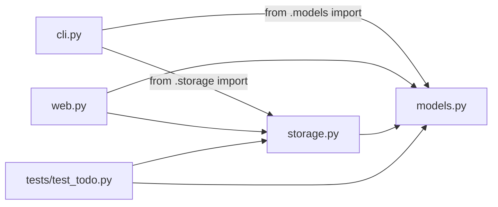

## The layout of every project

```
projects/beginner/todo_list/        ← a package (it has __init__.py)
├── __init__.py                     ← marks the folder as a package; a docstring describing it
├── __main__.py                     ← runs when you do: python -m projects.beginner.todo_list
├── models.py                       ← domain: Task, TodoList (pure logic)
├── storage.py                      ← persistence: JsonTodoStore
├── cli.py                          ← terminal interface
├── web.py                          ← Flask blueprint (+ standalone app)
├── templates/todo_list/index.html  ← HTML for the web interface
├── tests/                          ← pytest tests
│   ├── __init__.py
│   └── test_todo.py
└── README.md                       ← the guide you're reading on the site
```

## Modules, packages and imports
- A **module** is one `.py` file. A **package** is a folder with an `__init__.py`.
- Inside a package, use **relative imports** for siblings: `from .models import Task`.
- Across packages, use **absolute imports** from the repository root: `from projects.ui_kit import data_path`.



Notice the arrows only point **towards** the domain. `models.py` imports nothing from the project, so it is the most reusable file.

## Running code: `python -m`
Run modules from the repository root with `-m` and a dotted path:

```bash
python -m projects.beginner.todo_list add "Buy milk" -p high   # runs __main__.py → cli.main()
python -m projects.beginner.todo_list.web                      # runs web.py's  if __name__ == "__main__":
python -m pytest projects/beginner/todo_list                    # runs the tests
```

`-m` puts the current folder on Python's import path, so `from projects...` works without installing anything.

## `if __name__ == "__main__":`
A file's code runs when it's imported, too. The guard says "only do this when the file is run directly":

```python
def main() -> None:
    ...

if __name__ == "__main__":     # True for `python -m pkg.cli`, False for `from pkg.cli import main`
    main()
```

## Virtual environments
Each project you build should have its own isolated set of packages:

```bash
python -m venv .venv
source .venv/bin/activate          # Windows: .venv\Scripts\activate
pip install -r requirements.txt
```

`requirements.txt` lists what the project needs, and anyone can reproduce your setup with one command.
