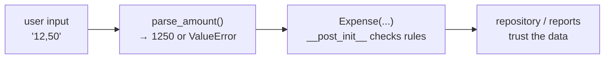

## Validate at the boundary, trust inside
Check data **once**, when it enters your domain (constructor, `__post_init__`, a `parse_` function). After that, the
rest of the code can trust it.



## Raise, don't return error codes

```python
# ❌ the caller can forget to check
def withdraw(self, cents):
    if cents > self.balance:
        return False

# ✅ impossible to ignore; the message travels with it
def withdraw(self, cents):
    if cents > self.balance:
        raise InsufficientFundsError(f"Only ${self.balance / 100:.2f} available.")
```

## Design an exception hierarchy

```python
class LibraryError(Exception): ...          # catch-all for this domain
class UnavailableError(LibraryError): ...   # specific failures
class LoanLimitError(LibraryError): ...
```

Interfaces catch the base class once and show the message. Tests assert the *specific* class. Exceptions can carry data
too: `ValidationError.errors` (Contact Book) maps field → message for a form, and `DomainError.status` (Kanban) holds an HTTP status.

## Catch specific exceptions, never everything

```python
try:
    value = Decimal(text)
except InvalidOperation:                                  # ✅ the one failure we expect
    raise ValueError(f"'{text}' is not an amount") from None

try:
    ...
except Exception:                                         # ❌ hides typos and real bugs
    pass
```

`raise ... from None` hides an internal exception the user doesn't need to see. `raise ... from error` keeps it for debugging.

## EAFP vs. LBYL
Python style prefers **EAFP**, "easier to ask forgiveness than permission":

```python
try:
    return self._tasks[task_id]
except KeyError:
    raise TaskNotFoundError(task_id) from None
```

instead of first checking `if task_id in self._tasks` (LBYL, "look before you leap"). Both are fine; EAFP avoids
doing the lookup twice and avoids race conditions with files.

## Error messages are UI
A good message says **what** was wrong and **how to fix it**: *"Line 3: Zoe isn't at the table."* beats
*"invalid input"*. The Mini Interpreter even points at the exact column with a `^`.
