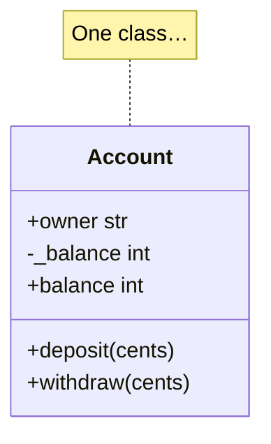

## A class is a blueprint, an object is a thing built from it



```python
ada = CheckingAccount("CHE-1001", "Ada")     # …many objects (instances), each with its own data
bob = CheckingAccount("CHE-1002", "Bob")
ada.deposit(5000, now)                        # changes ada's balance only
```

## `__init__` and `self`
`__init__` sets up a new object's attributes. `self` is the object the method was called on.
`ada.deposit(5000, now)` is really `CheckingAccount.deposit(ada, 5000, now)`.

```python
class Account:
    def __init__(self, number: str, owner: str):
        self.number = number          # instance attribute: each object has its own
        self.owner = owner
        self._balance = 0
```

## Instance vs. class attributes

```python
class DVD(LibraryItem):
    loan_days = 7                     # class attribute: shared by every DVD, overridable by subclasses

    def __init__(self, item_id, title, year, director, minutes):
        super().__init__(item_id, title, year)
        self.director = director      # instance attribute: this DVD's director
```

## Properties: computed attributes
A property looks like an attribute but runs code. It's perfect for values **derived** from other state, because they can never go stale:

```python
@property
def lives_left(self) -> int:
    return self.max_misses - self.mistakes

game.lives_left          # no parentheses
```

A property **without a setter** is read-only: `account.balance = 10**9` raises `AttributeError`. That's encapsulation.

## Encapsulation in Python
Python has no `private` keyword. Instead:
- `_name`: "internal, please don't touch from outside" (convention)
- `__name`: name mangling to `_Class__name` (rarely needed)
- expose behaviour through **methods** (`withdraw`) and read-only **properties** (`balance`)

## Dunder ("magic") methods
Built-in syntax calls special methods, so your classes can behave like built-in types:

| You write | Python calls | Example in this course |
|---|---|---|
| `len(bank)` | `__len__` | `QuestionBank`, `ContactBook` |
| `for c in book` | `__iter__` | `ContactBook` sorts favourites first |
| `a == b` | `__eq__` | `LibraryItem` (dataclasses generate it) |
| `repr(x)` | `__repr__` | `Account.__repr__` for debugging |
| `clock()` | `__call__` | `FakeClock`, `Mailer` (objects used as functions) |
| `hash(x)` / set membership | `__hash__` | frozen dataclasses |

## Alternative constructors with `@classmethod`

```python
@classmethod
def from_dict(cls, data: dict) -> Task:
    return cls(id=data["id"], title=data["title"], ...)
```

Use them for "build one from JSON", "start a new random game" (`GuessingGame.new`) and so on. `cls` makes them work for subclasses too.

## `@staticmethod`
A function that lives in the class for organisation but needs neither `self` nor `cls`, like `PasswordGenerator.passphrase_entropy(words)`.
