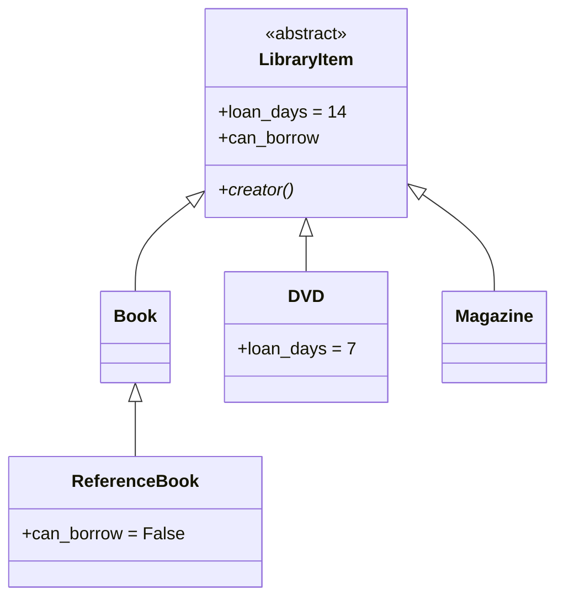

## Inheritance: "is a"



A subclass gets everything from its parent and can **add** attributes and **override** methods.
`super().__init__(...)` lets the parent set up its part first.

## Abstract base classes
`ABC` + `@abstractmethod` declares "every subclass must implement this":

```python
class Strategy(ABC):
    @abstractmethod
    def choose(self, history: list) -> str: ...

Strategy(rules)        # TypeError: can't instantiate an abstract class
```

## Polymorphism: same call, different behaviour

```python
# ❌ type checks everywhere - and you must edit them for every new type
if isinstance(item, DVD):
    days = 7
elif isinstance(item, Magazine):
    days = 7
else:
    days = 14

# ✅ ask the object
days = item.loan_days
```

The Library's `checkout`, the Bank's `run_month_end` and the Shop's `best_discount` all work this way: the caller
doesn't know or care which subclass it has.

## Duck typing
Python doesn't require a shared base class: *if it has the method, it fits*. Tests pass `random.Random(42)` where
code expects `secrets.SystemRandom`, and the event bus accepts any callable as a subscriber, whether a function, a bound
method or an object with `__call__`.

## Composition: "has a"
`Library` **has** items, members and loans. It doesn't *inherit* from `dict`. `Shop` **has** an inventory, an event bus
and a mailer. Composition is more flexible because you can swap parts (a different repository, a fake clock) without
changing class hierarchies.

| Ask | If yes |
|---|---|
| Is X a kind of Y, everywhere a Y is used? | inheritance can fit |
| Does X just need Y's help? | composition |
| Would the subclass have to *disable* parent behaviour? | ⚠️ rethink (see LSP in the next guide) |

> **Prefer composition over inheritance** is a famous guideline, not a law. Use inheritance for genuine *is-a*
> hierarchies with shared behaviour, and composition for everything else.
