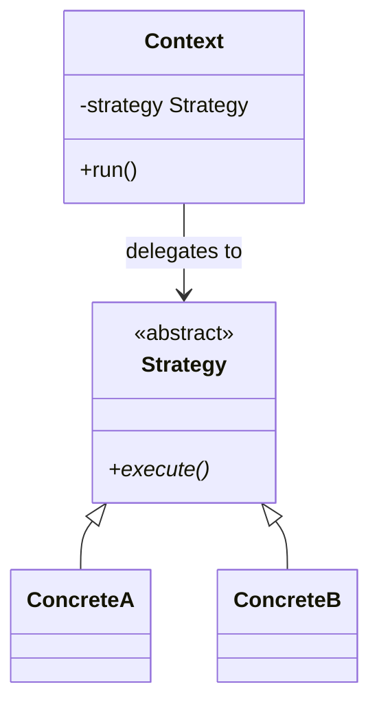

## SOLID, with examples from the projects

| Principle | In one sentence | Where you'll see it |
|---|---|---|
| **S**ingle responsibility | a module or class has one reason to change | `models.py` vs `storage.py` vs `web.py` in every project |
| **O**pen/closed | add behaviour by adding code, not editing it | new `Discount` / `Strategy` / `LibraryItem` subclasses |
| **L**iskov substitution | a subclass must work wherever its parent does | every `Account` handles `withdraw` and `month_end` |
| **I**nterface segregation | depend on small interfaces | `ExpenseRepository` Protocol lists only what the app uses |
| **D**ependency inversion | depend on abstractions, inject concrete parts | `KanbanService(repo)`, `Shortener(db, clock=...)` |

## Design patterns in this course

| Pattern | Problem it solves | Project |
|---|---|---|
| **Repository** | hide storage behind `add/get/list` | Expense Tracker, To-Do List, Kanban Board |
| **Strategy** | interchangeable algorithms | Rock Paper Scissors (opponents), Search Engine (rankers), Online Shop (discounts) |
| **Template method** | fixed algorithm, customisable steps | Bank (`withdraw` → `_check_withdrawal`), Search Engine (`Ranker.score`) |
| **Factory** | build the right class from a name | `make_strategy`, `Bank.open_account`, `item_from_dict` |
| **State machine** | only allowed transitions | Online Shop orders, Quiz flow |
| **Observer** (pub/sub) | react to events without coupling | Online Shop `EventBus` |
| **Command** | one object per action, found by name | Text Adventure |
| **Facade** | one simple entry point to many parts | `Shop` |

## Strategy pattern, the shape



```python
class Ranker(ABC):
    @abstractmethod
    def term_score(self, index, term, doc_id) -> float: ...

engine = SearchEngine(index, ranker=BM25Ranker())     # swap for TfIdfRanker() - nothing else changes
```

## Dependency injection, the pattern behind good tests
Pass in collaborators instead of creating them inside:

```python
class Shortener:
    def __init__(self, db_path, clock=lambda: datetime.now(timezone.utc)):
        self.clock = clock          # tests pass a FakeClock and control time
```

Randomness (`rng`), time (`clock`, `today`), storage (`repo`) and file paths are the four things you'll inject most often.

> Patterns are names for solutions that keep reappearing. Don't force them in. Recognise the problem first,
> then reach for the pattern that solves it.
