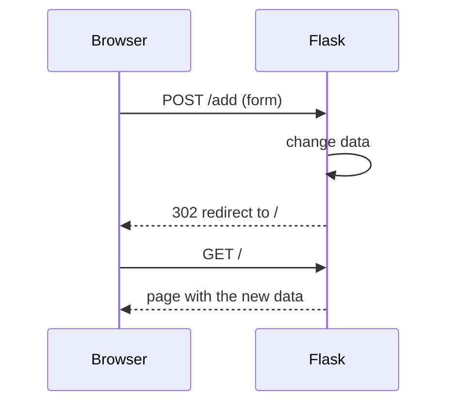

## Routes and templates

```python
from flask import Blueprint, render_template, request

bp = Blueprint("unit_converter", __name__, template_folder="templates")

@bp.get("/")
def index():
    value = float(request.args.get("value", "1"))          # query string: ?value=12
    return render_template("unit_converter/index.html", value=value)
```

Templates are Jinja2: `{{ value }}` prints (automatically **escaped**, which protects against HTML injection),
``/`` control flow, and `` reuses a layout.

## GET vs POST, and the POST-redirect-GET pattern



- **GET** reads, and must not change anything (it's bookmarkable and refreshable).
- **POST** changes data. Always **redirect** afterwards, so refreshing doesn't submit the form twice.

## Sessions and flash messages
`session` is a dict stored in a signed cookie, good for small state like a game in progress. It's **signed, not encrypted**:
the user can read it (see the Number Guessing exercise). `flash("Saved", "success")` shows a message on the next page.

## Blueprints
A blueprint is a mini-app (routes + templates) that can be mounted on any app. That's how all 20 projects run inside this
site at `/play/<project>/` **and** standalone with `python -m projects.<level>.<name>.web`.

## JSON APIs

```python
@bp.patch("/api/cards/<int:card_id>")
def update_card(card_id: int):
    card = service().move_card(card_id, **request.get_json())
    return jsonify(card.to_json())

@bp.errorhandler(DomainError)
def domain_error(error):
    return jsonify(error=str(error)), error.status
```

## Security basics the projects follow
- Bind development servers to `127.0.0.1`, never `0.0.0.0`, unless you mean to share them.
- Never build SQL with f-strings; use `?` placeholders.
- Send secrets (passwords) with POST, never in URLs.
- Insert user text in JavaScript with `textContent`, not `innerHTML`.
- Validate every input on the server, even if the HTML form has `required`.
