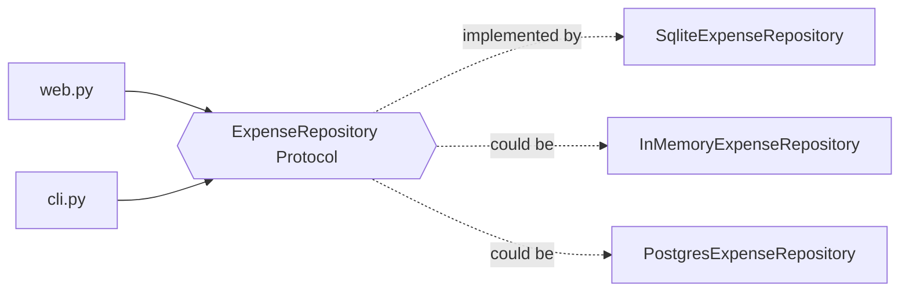

## Why the Repository pattern?

The web and CLI code only call `add`, `in_month`, `budgets`… They don't know SQL exists. Moving to PostgreSQL means
writing one new class, and the reports, templates and tests of the reports don't change.
